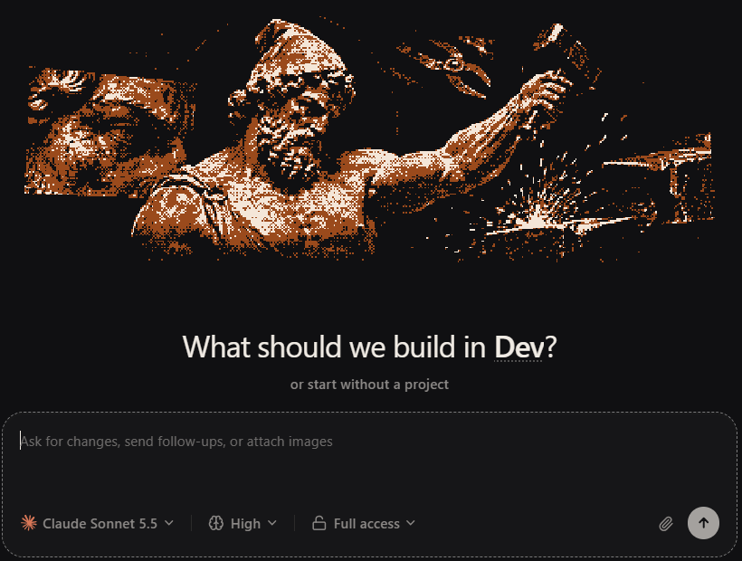
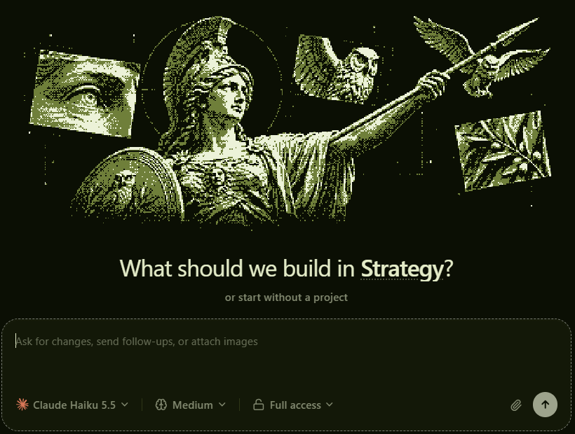
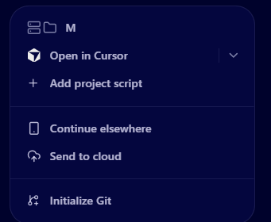

# T3 Olympus

Agent profiles, each with its own Greek god, for the [T3 Code](https://t3.codes) desktop app.

Each profile is a T3 project with its own instructions, and opening a chat in it switches T3 to that profile's god: the statue at the top of the sidebar, the collage at its foot, the big figure over a new chat and the whole colour palette. Add a few extras on top: hand a chat off to your phone or the cloud, and hover a profile to see what it works on.

| Dev, under Hephaestus | Strategy, under Athena |
|---|---|
|  |  |

## What you get

- **18 god themes.** Olympus, Hera, Poseidon, Demeter, Athena, Apollo, Artemis, Ares, Aphrodite, Hephaestus, Hestia, Dionysus, Caduceus (Hermes), Hades, Nyx, Helios, Selene and Medusa, in dithered classical marble. Each works in light and dark mode, and the window's minimize, maximize and close buttons follow the theme you see.
- **One god per profile.** Open a chat in Dev and T3 turns to Hephaestus; open one in Strategy and it turns to Athena. Pick a different god with **Ctrl+Alt+A** while you're in a profile and it becomes that profile's god from then on.
- **Continue elsewhere.** Keeps the same Claude conversation running in the background with Remote Control, so you can pick it up in Claude desktop, claude.ai or the Claude phone app.
- **Send to cloud.** Claude writes a handoff note from the chat, then starts a Claude Code cloud session with it.
- **Profile cards.** Rest the mouse on a profile in the sidebar for a moment and a card shows what that profile works on, its folders and its latest chats. Haiku writes the summary, and only re-reads a profile when its chats change.
- **Dictation.** A microphone button that types what you say, using Claude Code's own speech-to-text.
- **Split view.** Drag a chat onto the chat area to open it side by side.
- **Temporary chats.** A chat that isn't saved and is deleted when you leave it.
- **Context and connectors.** The Ctrl+Shift+B tray shows how full the chat's context is and which connectors Claude has.
- **Next-step card.** Claude ends a turn with a recap and answer buttons above the message box, as in Claude desktop.
- **Chat sorting.** Chats T3 imports from Claude Code land in one project per folder. T3 Olympus files them into your profiles by rules you set.
- **Survives T3 updates.** Open T3 from the **T3 Olympus** shortcut and it puts everything back if an update removed it.



## Requirements

- Windows 10 or 11
- [T3 Code](https://t3.codes) desktop app, installed for your user (the default)
- Python 3.10 or newer, with `pythonw` (the python.org installer includes it)
- For the hand-off buttons and profile cards: [Claude Code](https://code.claude.com) signed in (`claude` on your PATH) and Windows Terminal (`wt`)

## Install

```bash
git clone https://github.com/bigot41/t3-olympus.git
```

```bash
python t3-olympus/install.py
```

The installer copies the 18 themes into T3, creates `config.json` and `gods.json` from the examples, and adds a **T3 Olympus** shortcut to the Start Menu and Desktop. It also puts the helper in your Startup folder, so the buttons and cards work even when T3 opens some other way, such as after an in-app update. Close T3, then open it from that shortcut. From now on, always open T3 that way.

## Set up your profiles

A profile is a folder inside `profiles_dir` (default `~/Projects/_profiles`) that is also a T3 project.

The quick way:

```bash
python new_profile.py gamedev hephaestus --agent
```

That makes the folder with a starter `CLAUDE.md`, adds it to T3 and sets its god. `--agent` also writes `~/.claude/agents/gamedev.md`, so other chats can hand work to it. Rewrite the `CLAUDE.md` for the role, then reopen T3 from the shortcut.

By hand:

1. Make the folder, for example `~/Projects/_profiles/gamedev`. Copy `profile-template/CLAUDE.md` into it and rewrite it for the role: that file is the agent's instructions.
2. In T3, add the folder as a project (the folder icon next to **Projects** in the sidebar). It shows up as **Gamedev**.
3. Open a chat in it, press **Ctrl+Alt+A** and pick its god.

Name one profile `general` (or change `default_profile` in `config.json`): chats that match no rule go there.

## Configure

`config.json` (created from `config.example.json`, never committed):

| Key | What it does |
|---|---|
| `projects_dir` | Where your project folders live. |
| `profiles_dir` | Where your profile folders live. |
| `default_profile` | Where chats go when no rule matches. |
| `remove_empty_projects` | `true` to remove T3 projects outside `profiles_dir` once sorting leaves them with no chats. Off by default. |
| `buttons_show_in` | `"all"`, or a list of profile names such as `["Dev", "Marketing"]`, for the hand-off buttons. |
| `folders` | Folder name, or the start of one, under `projects_dir` → profile. The first match wins, so list sub-folders first. |
| `topics` | Exact chat title → profile, for chats started in `projects_dir` itself. |
| `archive` | Parts of a path that mark test runs. Those chats are archived into the default profile. |

`gods.json` maps each profile to its god. Ctrl+Alt+A updates it for you, but you can edit it by hand too. The names are the theme names in lowercase; Ares is `mars`.

Every time the shortcut opens T3, it sorts newly imported chats into your profiles (and, with `remove_empty_projects` on, removes the folder projects left empty). It backs up T3's data to `~/.t3/userdata-backup-<time>` before moving anything. To see what it would do first, close T3 and run:

```bash
python organize.py --dry-run
```

## The hand-off buttons

Open a chat and press **Ctrl+Shift+B**. The tray in the top right has a **Hand off** section:

- **Continue elsewhere** runs `claude --bg --resume <session> --remote-control`. It's the same conversation with the same history, now running in the background, and a pop-up gives you its claude.ai link. Carry on there rather than in the T3 chat, or the two copies drift apart. Pressing it again reuses the same background session. Stop it with `claude stop <id>`.
- **Send to cloud** opens a terminal. Claude writes a handoff note from a copy of the chat (saved in `handoffs/`), then runs `claude --cloud` with it. A cloud session can't see your computer, so anything it needs has to be in the note or on GitHub. The first time, Claude Code may show its one-time setup screen in that terminal: finish it and the cloud session starts.

## Dictation

The microphone button in the message box works like Claude Code's `/voice`: click it and speak, the words appear above the box as you talk, and click again (or press Esc) to put the text in the message box. Nothing is sent until you press send.

It uses Claude Code's own speech-to-text service, signed in with your Claude Code login (`~/.claude/.credentials.json`). The helper makes the connection, so the login never reaches T3's page. That service is undocumented and meant for Claude Code itself, so a Claude Code update can change or close it. If that happens, dictation shows the error and everything else keeps working. If your Claude Code sign-in has expired, send any message in a Claude chat to renew it.

## Split view

Drag a chat from the sidebar onto the chat area and it opens beside the current one, as in Claude desktop. Two chats side by side is the most: with a split open, drag a chat onto either side and it replaces the chat there (the side under the pointer is outlined). **New thread** (or Ctrl+N with the left chat focused) starts a new chat on the left and keeps the right one. Dropping a chat on a message box adds it there as a chip instead; hover a chip and click × (or use Backspace or Delete) to remove it. Each side is a full chat with its own message box. Drag the dotted divider to resize it, and × closes it. It comes back if T3 reloads.

The second pane is T3 itself in a frame, so it uses some extra memory while it's open.

## Temporary chats

The dashed-chat button next to **New thread** starts a temporary chat, like ChatGPT's. It works like any chat (models, files, tools), with a **Temporary chat** label and a dashed message box so you always know. It never shows in the sidebar or the project chooser, and when you leave it, it's deleted.

How it works and what it can't promise:

- It's a normal chat in a hidden **Temporary** project (`~/.t3/olympus-temporary`). That folder turns Claude's automatic memory off, so nothing is read from or written to memory. Your own `~/.claude/CLAUDE.md` and permission settings still apply, as for every chat.
- When you leave it, T3's own delete command removes it, and the helper deletes Claude Code's transcript, file snapshots and session files, T3's log for that chat, and files you uploaded.
- T3's delete only marks a chat deleted, so the next time the shortcut opens T3 (with T3 closed) the launcher removes every remaining row for deleted temporary chats from T3's database and compacts it. Chats left open when T3 closed or crashed are deleted the next time T3 opens.
- While the chat is open it is on disk like any chat. T3's general trace logs may hold fragments. Anthropic receives the messages to answer them and keeps them under your account's data settings.

## Context and connectors

The Ctrl+Shift+B tray also has a **Context** and **Connectors** section, like Claude desktop's side panel. It shows how full the open chat's context window is, and the connectors (MCP servers) Claude has in that chat's folder, with a green or red dot for whether each one is connected. It refreshes every 20 seconds while the tray is open.

## The next-step card

Like Claude desktop, Claude can end a turn with a short recap and, when the next move is yours, one question with one or two answer buttons. The card sits just above the message box; a button sends its reply for you, and × hides it. It goes away once you reply.

It comes from a small tool, `wrap_up` (`wrapup_mcp.py`), which the installer and `new_profile.py` turn on for each profile. To turn it on for any other folder:

```bash
python wrapup_mcp.py --register "C:/path/to/folder"
```

## Getting around T3

| Keys | What it does |
|---|---|
| Ctrl+K | Command palette: every action by name, including Settings |
| Ctrl+B | Show or hide the sidebar |
| Ctrl+N | New chat in the current profile |
| Ctrl+Shift+[ and ] | Previous and next chat |
| Ctrl+Shift+B | Chat details tray, with the hand-off buttons |
| Ctrl+Alt+B | Right panel: summary, plan, agents, files, diff, terminal, browser |
| Ctrl+Shift+M / Ctrl+Shift+E | Model / effort |
| Ctrl+U | Usage and plan limits |
| Ctrl+Alt+A | Pick a god for the current profile |

## How it works

T3 serves its interface from `resources/server.asar`. `patch.py` marks the interface's `index.html` as "unpacked" in that archive and writes a copy with one extra line into `server.asar.unpacked`, next to `olympus.css` (the art and layout) and `olympus.js` (the god switcher, buttons and cards). Nothing else in T3 changes, and the original archive is kept as `server.asar.olympus-orig`.

`helper.py` is a small local server on `127.0.0.1:47833` that only answers T3's own window. It looks up a chat's Claude Code session in T3's database and runs the `claude` CLI on it, saves god picks and builds the profile cards.

| File | Purpose |
|---|---|
| `install.py` | One-time setup: themes, config files, shortcuts, Startup entry; `--uninstall` |
| `launch.pyw` | What the shortcut runs: re-patch if needed, sort chats, start the helper, open T3 |
| `patch.py` | Adds T3 Olympus to T3, or `--restore` takes it out |
| `olympus.js`, `cards.js`, `nextstep.js`, `panel.js`, `temporary.js`, `split.js`, `voice.js`, `chips.js` | The code that runs inside T3 |
| `voice.py` | Dictation: streams your microphone to Claude Code's speech-to-text service |
| `temporary.py` | Temporary chats: the hidden project, file cleanup and database scrub |
| `tests/` | `python -m unittest discover tests` |
| `helper.py` | Local helper for the buttons, god picks and cards |
| `send_to_cloud.py` | Handoff note, then `claude --cloud` |
| `wrapup_mcp.py`, `nextstep.js` | The next-step card: the `wrap_up` tool, and the card in T3 |
| `cards_build.py` | Writes the profile cards (`python cards_build.py` rebuilds them all) |
| `new_profile.py` | Makes a profile: folder, T3 project, god |
| `organize.py` | Sorts chats into profiles |
| `themes/`, `art/` | The 18 palettes and 54 god images |

## Uninstall

Close T3, then:

```bash
python install.py --uninstall
```

```bash
python patch.py --restore
```

The first removes the shortcuts, the Startup entry and the themes; the second takes T3 Olympus out of T3.

## Credits

The god art and palettes come from [Pantheon](docs/PANTHEON-LICENSE.txt) by Adolanium, a theme pack for Hermes Desktop, under the MIT license. T3 Olympus isn't affiliated with T3 Code, Anthropic or Nous Research.

## License

MIT. See [LICENSE](LICENSE).
